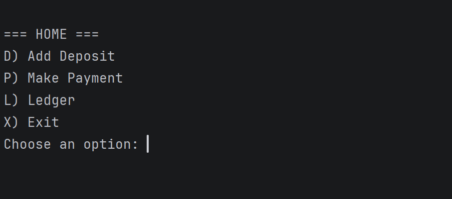
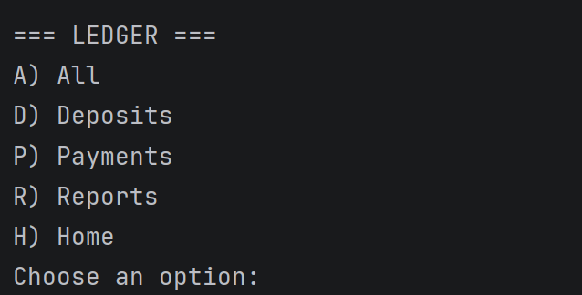
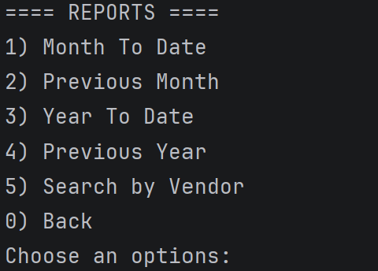

# Accounting Ledger

An app for tracking every deposit and payment for a business or for personal use. Transactions are saved in a file, so they are still there next time you run the app.

## Features

- Add a deposit or make a payment. The app already fills in the today's date and the current time.
- The user can view all transactions or view payments and deposits separately.
- Entries are listed oldest first, and the newest at the bottom.
- Generate Reports: Month To Date, Previous Month, Year To Date, Previous Year, and Search by Vendor.
- Messages for a wrong menu choice, a bad amount, or a report with no matches.
- Save and load transactions using a CSV file.

## How to run it

1. Clone the repository and open it in IntelliJ
2. Run `[AccountingLedgerApp].java`
3. Type a letter from the Home menu, like `L` for the Ledger, and press Enter

## Interesting code

The Previous Month report needs to handle January, where if the previous month is December of last year. Instead of using an if for that case, minusMonths(1) does it for me, because Java changes the year when it has to.
LocalDate lastMonth = LocalDate.now().minusMonths(1);
```java
LocalDate lastMonth = LocalDate.now().minusMonths(1);
boolean found = false;

        for (Transaction transaction : transactions) {
LocalDate date = transaction.getDate();
            if (date.getMonthValue() == lastMonth.getMonthValue() && date.getYear() == lastMonth.getYear()) {
printTransaction(transaction);
found = true;
        }
}
```
## Screenshots





## Author
Aup Ramavarapu, Year Up Java Academy


